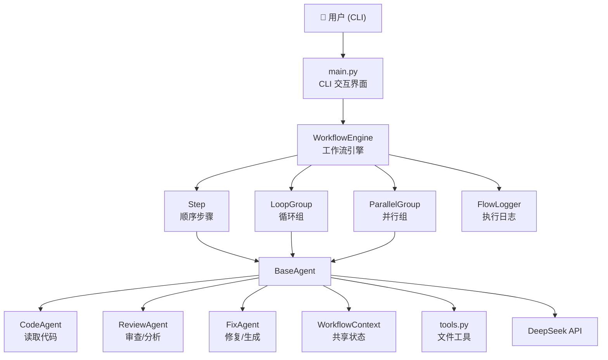
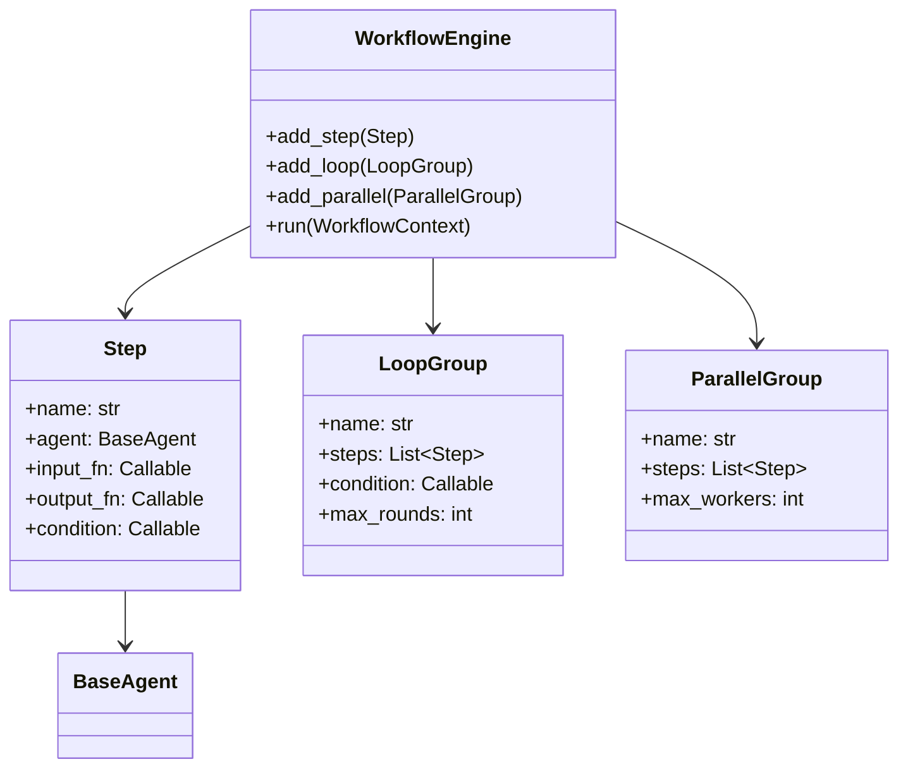
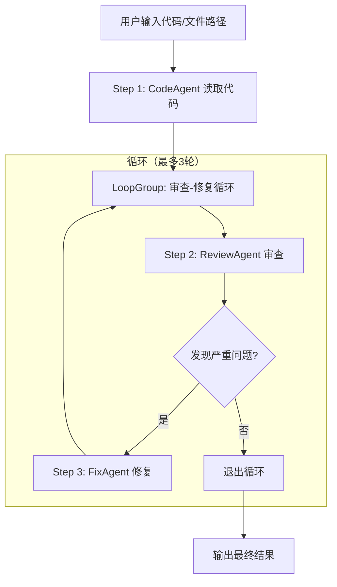
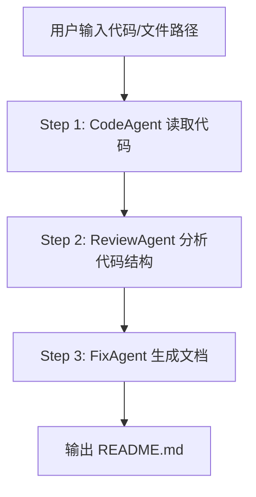
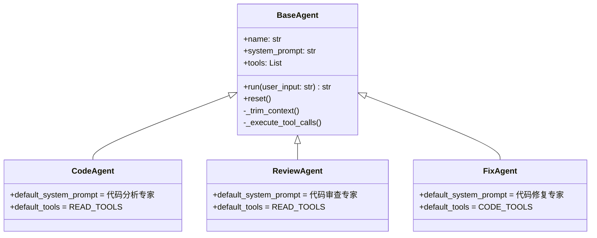
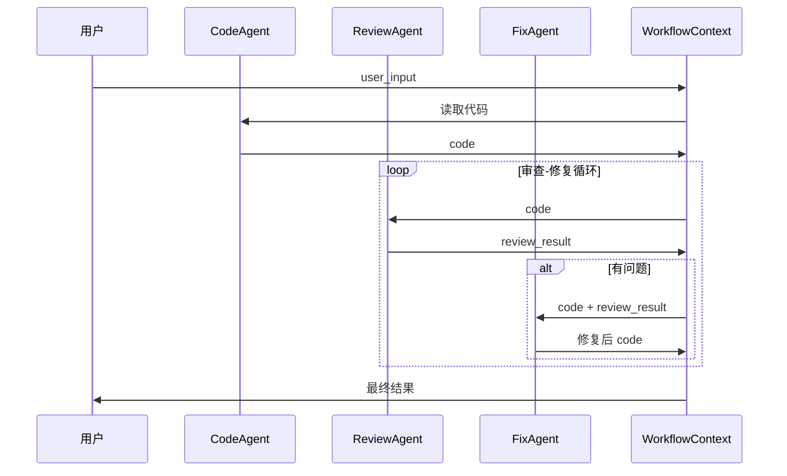
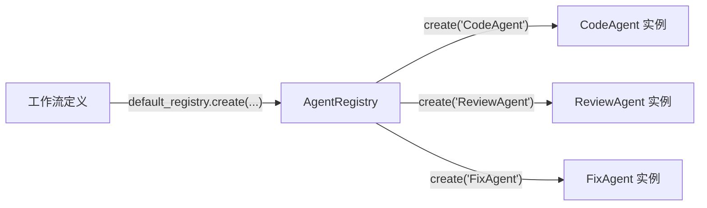
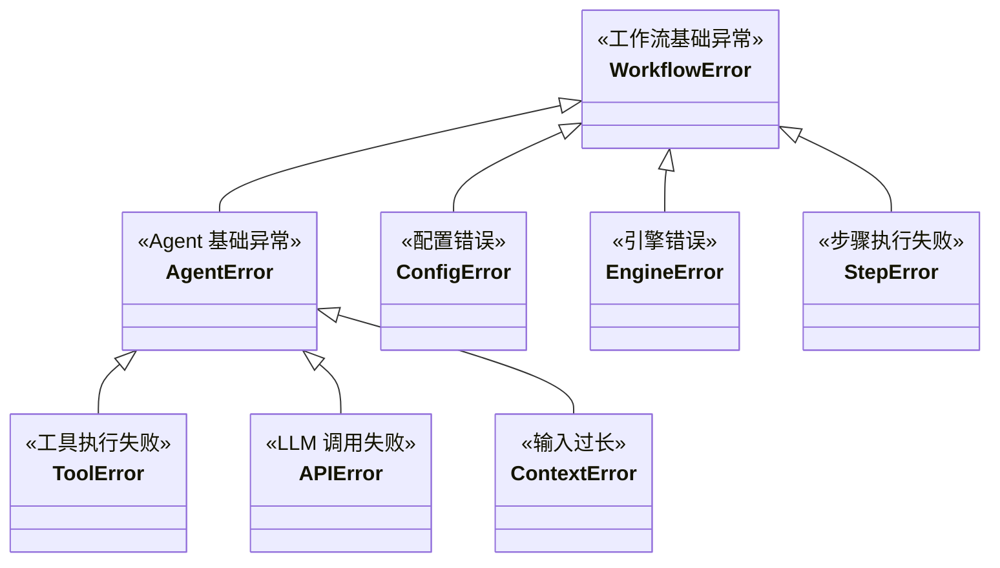

# 📐 设计文档 - 多 Agent 协同工作流系统

## 1. 架构概述

### 1.1 系统架构图



### 1.2 组件职责

| 组件 | 文件 | 职责 |
|------|------|------|
| CLI 界面 | `main.py` | 命令行交互、多工作流选择、命令处理 |
| 工作流引擎 | `workflow/engine.py` | 步骤编排、条件分支、循环控制、并行执行 |
| 共享上下文 | `workflow/context.py` | Agent 间数据传递、状态记录 |
| 执行日志 | `workflow/flow_logger.py` | 实时打印、执行摘要 |
| Agent 基类 | `agents/base.py` | LLM 调用、消息管理、上下文裁剪、可配置 prompt/tools |
| 编码 Agent | `agents/code_agent.py` | 读取代码文件、理解代码结构 |
| 审查 Agent | `agents/review_agent.py` | 分析代码质量、可主动查阅文件 |
| 修复 Agent | `agents/fix_agent.py` | 修复代码、可执行测试验证 |
| Agent 注册表 | `agents/registry.py` | Agent 注册与发现，支持动态创建 |
| 工具集 | `tools.py` | 文件读取、目录浏览、代码搜索、代码执行 |

## 2. 工作流引擎设计

### 2.1 核心抽象



### 2.2 执行流程（代码审查工作流）



### 2.3 执行流程（文档生成工作流）



### 2.4 关键设计决策

1. **Step 抽象**：通过 `input_fn`/`output_fn` 与上下文交互，解耦 Agent 与工作流逻辑
2. **条件执行**：Step.condition 控制单步是否执行，LoopGroup.condition 控制循环是否继续
3. **并行执行**：ParallelGroup 使用 `ThreadPoolExecutor` 并发执行独立任务
4. **最大轮次**：防止无限循环，默认 3 轮
5. **通用轮次计数**：`ctx.set(f"{loop.name}_round", n)` 避免硬编码业务字段

## 3. Agent 设计

### 3.1 Agent 层次结构



### 3.2 Agent 工具分配

| Agent | 工具 | 设计理由 |
|-------|------|----------|
| CodeAgent | read_file, list_directory, search_code | 需要遍历项目结构、读取多个文件 |
| ReviewAgent | read_file, list_directory, search_code | 审查时需查阅依赖文件、搜索引用 |
| FixAgent | read_file, list_directory, search_code, execute_python | 修复后可运行测试验证 |

### 3.3 Agent 通信方式

Agent 通过 **WorkflowContext** 间接通信，支持两种模式：

- **单向流水线**：A 输出 → ctx → B 输入（当前实现）
- **反馈循环**：通过 LoopGroup 实现 A → B → 判断 → A 的循环审查



### 3.4 可配置 System Prompt

Agent 支持通过构造函数传入自定义 `system_prompt` 和 `tools`：

```python
# 使用默认配置
agent = ReviewAgent()

# 自定义审查标准
agent = ReviewAgent(system_prompt="请按照 PEP8 标准审查代码...")

# 自定义工具集
agent = FixAgent(tools=[read_file, execute_python])
```

## 4. 共享状态设计 (WorkflowContext)

### 4.1 数据模型

```python
class WorkflowContext:
    _data: Dict[str, Any]       # 通用键值对存储（无模式）
    _step_results: List[Step]   # 步骤执行记录
    _status: str                # pending | running | completed | failed
```

### 4.2 数据流向

```mermaid
flowchart LR
    A["Step 1 输出"] -->|ctx.set('code', output)| B["WorkflowContext"]
    B -->|ctx.get('code')| C["Step 2 输入"]
    C -->|ctx.set('review_result', output)| B
    B -->|ctx.get('code') + ctx.get('review_result')| D["Step 3 输入"]
    D -->|ctx.set('code', fixed)| B
```

## 5. Agent 注册机制



使用注册表的好处：
- 新增 Agent 只需 `registry.register(NewAgent)`，无需修改工作流代码
- 支持运行时动态选择 Agent
- 工作流定义与 Agent 实现解耦

## 6. 异常处理

### 6.1 异常类层次



### 6.2 错误处理策略

| 场景 | 处理方式 |
|------|----------|
| API Key 未设置 | raise ConfigError，提示设置方法 |
| LLM 调用失败 | Agent 内部回滚消息历史，raise APIError |
| 工具执行失败 | 工具内部 raise ToolError，Agent 转为 ToolMessage |
| 步骤执行失败 | Engine 捕获，记录到执行日志，raise EngineError |
| 循环超过最大轮次 | 自动退出循环，输出当前结果 |
| 并行步骤部分失败 | 记录失败步骤，不影响其他步骤 |

## 7. 可扩展性设计

### 7.1 新增 Agent

```python
# 1. 继承 BaseAgent
class TestAgent(BaseAgent):
    name = "TestAgent"
    default_system_prompt = "..."
    default_tools = [...]

# 2. 注册到注册表
default_registry.register(TestAgent)

# 3. 在工作流中使用
agent = default_registry.create("TestAgent")
```

### 7.2 新增工作流

```python
def build_test_workflow() -> WorkflowEngine:
    engine = WorkflowEngine(name="测试工作流")
    engine.add_step(Step(...))
    engine.add_loop(LoopGroup(...))
    engine.add_parallel(ParallelGroup(...))
    return engine
```

### 7.3 并行步骤

```python
engine.add_parallel(ParallelGroup(
    name="多文件审查",
    steps=[
        Step("审查文件A", agent, ...),
        Step("审查文件B", agent, ...),
    ],
    max_workers=4,
))
```

## 8. 已知限制与未来改进

### 当前限制

1. **Agent 间无直接通信**：当前是单向数据流（流水线模式），Agent 无法向其他 Agent 追问或协商。LoopGroup 提供了间接反馈循环，但不是真正的 Agent 间对话。

2. **并行步骤共享上下文**：并行步骤写入同一个 WorkflowContext，如果多个步骤写入相同 key 可能产生竞态。适用于写入不同 key 的独立任务。

3. **System Prompt 硬编码为默认值**：虽然支持构造函数覆盖，但默认 prompt 仍以字符串常量定义在代码中，非配置文件驱动。

4. **单用户 CLI 场景**：当前设计面向单用户命令行使用，未考虑多用户并发或 Web 服务场景。

### 未来改进方向

1. **Agent 间直接通信**：引入消息总线或请求-响应机制，允许 Agent 互相追问
2. **配置驱动工作流**：通过 YAML/JSON 定义工作流，无需写 Python 代码
3. **持久化状态**：支持工作流断点续跑、执行历史持久化
4. **可视化编排界面**：拖拽式工作流设计器
5. **并行步骤安全写入**：为每个并行步骤提供独立的上下文副本，合并后写入主上下文

## 9. 测试策略

### 9.1 测试覆盖

| 测试文件 | 用例数 | 覆盖范围 |
|----------|--------|----------|
| test_tools.py | 22 | 4 个工具的功能和边界 |
| test_agents.py | 30 | Agent 初始化、run() 循环、工具调用、裁剪 |
| test_engine.py | 29 | 引擎编排、条件分支、循环、并行 |
| test_workflow.py | 15 | 结论解析、端到端集成、文档生成 |
| test_flow_logger.py | 17 | 执行日志全流程 |
| test_main.py | 13 | CLI 命令处理、工作流配置 |
| test_registry.py | 7 | Agent 注册与发现 |
| **合计** | **138** | |

### 9.2 测试方法

- **Mock LLM**：使用 `unittest.mock.patch` 模拟 ChatOpenAI
- **Mock Agent**：验证工作流引擎的编排逻辑
- **Mock Registry**：隔离工作流定义与 Agent 实现
- **临时文件**：使用 pytest `tmp_path` fixture 测试工具